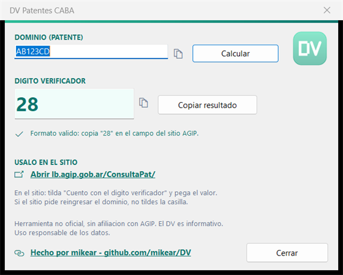

<div align="center">

# DV Patentes CABA

**Calculadora portátil del dígito verificador de patentes de la Ciudad Autónoma de Buenos Aires**

[](https://github.com/mikear/DV/releases/latest)
[](https://github.com/mikear/DV/releases/latest)
[](LICENSE)
[](https://github.com/mikear/DV/releases/latest)
[](#uso-rápido)
[](DISCLAIMER.md)



Ejecutable único. Sin conexiones propias. Cero instalación. Código fuente incluido.

Hecho por [mikear](https://github.com/mikear/DV) — <https://github.com/mikear/DV>

[Cómo verificar el archivo](#verificación-y-auditoría) · [El algoritmo](ALGORITMO_DV.md) · [Aviso legal](DISCLAIMER.md)

</div>

---

## Índice

- [Qué hace](#qué-hace)
- [Inicio rápido](#inicio-rápido)
- [Uso](#uso)
- [Formatos aceptados](#formatos-aceptados)
- [El algoritmo](#el-algoritmo)
- [Verificación y auditoría](#verificación-y-auditoría)
- [Privacidad](#privacidad)
- [Sobre los antivirus](#sobre-los-antivirus)
- [Aviso legal](#aviso-legal)
- [Contribuir](#contribuir)
- [Licencia](#licencia)

## Qué hace

El sitio de [AGIP](https://lb.agip.gob.ar/ConsultaPat/) pide un **dígito verificador**
para mostrar los datos de una patente. Este programa lo calcula en tu computadora,
sin que la app se conecte a internet y sin instalar nada.

| | |
|---|---|
| **Sin red propia** | La app no abre conexiones, no envía ni recolecta datos. El enlace del pie abre el navegador sólo si lo clickeás. |
| **Sin instalación** | Es un `.exe` portátil: no muestra asistente, no deja nada en el sistema, no hay desinstalador. |
| **Sin cmd ni PowerShell** | El portapapeles se maneja con API nativa de Win32. El loader de Inno ejecuta una copia temporal del propio binario. |
| **Con auditoría** | Trae el código fuente, los vectores de prueba y la documentación del algoritmo. |
| **Con autotest** | Antes de abrir la ventana (y antes del modo archivo) corre un autotest de humo que cubre las 26 letras y casos negativos; la batería completa de 432 casos está en `test-paridad.js`. |

## Inicio rápido

1. Descargá el zip de la [última release](https://github.com/mikear/DV/releases/latest), descomprimilo y ejecutá `dv-caba-portable.exe`.
2. Verificá el hash y ejecutalo. No hace falta instalar nada.
3. Escribí el dominio, apretá **Calcular** y copiá el resultado.

**Requisitos:** Windows 10 1607 o superior (Windows 11 incluido). La app usa
`GetDpiForWindow` y la tipografía `Segoe MDL2 Assets` para los glifos.

¿Prefieres no descargar nada? Pegá `snippet-consola.js` en la consola del
navegador con el sitio de AGIP abierto y te completa el campo solo.

## Uso

### Interfaz gráfica

Abrí el `.exe`, escribí el dominio y apretá **Calcular**. El resultado aparece
en grande, con dos accesos rápidos: el icono de copia junto al dominio y el
botón **Copiar resultado**. El enlace inferior abre el sitio oficial.

### Línea de comandos

```text
dv-caba-portable.exe                     -> abre la app
dv-caba-portable.exe AB123CD             -> app con el dominio precargado
dv-caba-portable.exe AB123CD C:\r.txt    -> escribe "DV=28" y sale (exit 0 = ok, 2 = error)
dv-caba-portable.exe --copy 28           -> copia al portapapeles (exit 0 = ok, 2 = error)
```

Un argumento que empieza con `/` nunca se interpreta como archivo de salida.

### Consola del navegador

Con el sitio de AGIP abierto, pegá el contenido de
[`snippet-consola.js`](snippet-consola.js) en la consola (F12). Calcula el DV
del campo y lo escribe en el formulario.

### Versión en Node

```bash
node dv.js AB123CD          # => DV: 28
node dv.js AB123CD ABC123 A1234567
```

## Formatos aceptados

| Tipo | Estructura | Ejemplo | DV |
|---|---|---|---|
| Auto Mercosur | 2 letras · 3 dígitos · 2 letras | `AB123CD` | 28 |
| Auto nueva | 3 letras · 3 dígitos | `ABC123` | 57 |
| Auto vieja | 1 letra · 7 dígitos | `A1234567` | 73 |
| Moto Mercosur | 1 letra · 3 dígitos · 3 letras | `A123BCD` | 37 |
| Moto nueva | 3 dígitos · 3 letras | `123ABC` | 93 |

## El algoritmo

El dígito verificador es una operación aritmética pura: tabla de letras,
suma por paridad e iteración de raíz digital.

```text
AB123CD
  → sustituir letras por la tabla (A=14, B=01, C=00, D=16)   "14011230016"
  → sumar por paridad de índices                              a=11  b=8
  → raíz digital de cada suma                                 2  y  8
  → concatenar                                                DV = 28
```

La reconstrucción completa, con ejemplo trabajado, particularidades del
original, IDs de evidencia y limitaciones está en
[**ALGORITMO_DV.md**](ALGORITMO_DV.md).

## Verificación y auditoría

Este proyecto existe para ser auditable. Tres formas de verificarlo:

**1. Por hash**

```powershell
Get-FileHash .\dv-caba-portable.exe -Algorithm SHA256
```

Comparalo con `SHA256SUMS.txt`, incluido en la release y en el paquete.

**2. Reconstruyendo el binario**

Necesitás [Inno Setup 6](https://jrsoftware.org/isinfo.php):

```powershell
iscc.exe dv-caba.iss
```

En el paquete, el script está en `fuente\` y los iconos en `fuente\iconos\`:

```powershell
iscc.exe fuente\dv-caba.iss
```

**3. Corriendo los tests**

```bash
node test-paridad.js
# 432 casos: 1282 comprobaciones contra el original de AGIP
#            432 comprobaciones con los vectores dorados (paquete público)
```

### Qué incluye el paquete

```text
dv-caba-portable-osint/
├── dv-caba-portable.exe     ejecutable portátil
├── SHA256SUMS.txt           hash de cada archivo
├── README.md                este documento
├── ALGORITMO_DV.md          reconstrucción del algoritmo
├── DISCLAIMER.md            aviso legal completo
├── LICENSE                  MIT
└── fuente/                  código fuente para auditar
    ├── dv-caba.iss          script de Inno Setup 6
    ├── dv.js                implementación de referencia
    ├── test-paridad.js      batería de pruebas
    ├── snippet-consola.js   utilidad para el navegador
    └── iconos/              icono y recursos que usa el .iss
        ├── dv-caba.ico
        ├── preview-64.png
        └── accent-teal.png
```

**Qué no incluye**: el JavaScript original de AGIP (es código de terceros) ni
archivos de evidencia. Los tests corren contra vectores dorados congelados,
generados y verificados contra el original en el entorno privado.

## Privacidad

- La app no abre conexiones de red; el enlace del pie abre el navegador recién
  cuando lo clickeás.
- No recolecta ni envía datos.
- No escribe en el registro de Windows ni instala nada. El modo CLI escribe
  únicamente el archivo de salida que le indiques.
- El resultado se calcula localmente a partir del texto que tipeás.
- Si usás `/LOG=...`, Inno puede guardar un log local; no se envía a ningún lado.

## Sobre los antivirus

Algunos antivirus señalan binarios desconocidos, sin firmar y empaquetados con
heurística en la nube. Es un **falso positivo** típico, no una detección de
comportamiento: el binario no hace red, no invoca `cmd` ni `powershell` para el
cálculo y no instala nada. El loader de Inno ejecuta una copia temporal del
propio binario y el enlace abre el navegador sólo si lo clickeás.

Si tu antivirus lo bloquea:

- Verificá el hash contra `SHA256SUMS.txt`.
- Reconstruí el ejecutable desde `dv-caba.iss` (en el paquete:
  `fuente\dv-caba.iss` con `fuente\iconos\`) y compará.
- Pedí la revisión en [Microsoft Security Intelligence](https://www.microsoft.com/wdsi/filesubmission)
  o en [McAfee Threat Submission](https://www.mcafee.com/us/consumer-support/other-threats/false-positive-reporting.html).
- **No lo subas a VirusTotal** antes de ese trámite: VT comparte las muestras
  con todos los fabricantes y puede consolidar la detección en vez de levantarla.

## Aviso legal

> **Herramienta no oficial, sin afiliación con AGIP.** El DV es informativo:
> AGIP expresa que su consulta "carece de valor documental alguno".

Hay un punto que conviene tener presente. AGIP advierte en su sitio:

> "Por resguardo del secreto fiscal, las boletas obtenidas sin dígito
> verificador no contendrán los datos del contribuyente (nombre y dirección)."

Es decir: al aportar el DV, el sitio puede devolver **datos personales de una
persona**. Usá esta herramienta **sólo con fines lícitos** y propios, y conforme
a la Ley 25.326 de Protección de Datos Personales.

Texto completo en [**DISCLAIMER.md**](DISCLAIMER.md).

## Contribuir

Todo aporte es bienvenido: reportes de error, correcciones del algoritmo ante
cambios de AGIP, mejoras de la GUI o traducciones.

- Reportá bugs con la [plantilla de problemas](https://github.com/mikear/DV/issues/new/template/bug_report.yml).
- Leé [CONTRIBUTING.md](CONTRIBUTING.md) antes de mandar un pull request.
- Encontraste una vulnerabilidad? No abras un issue público: ver [SECURITY.md](SECURITY.md).

## Licencia

Distribuido bajo [licencia MIT](LICENSE). Copyright (C) 2026 mikear.

<div align="center">

Si te sirvió, dejá una estrella

[](https://star-history.com/#mikear/DV&Date)

</div>
